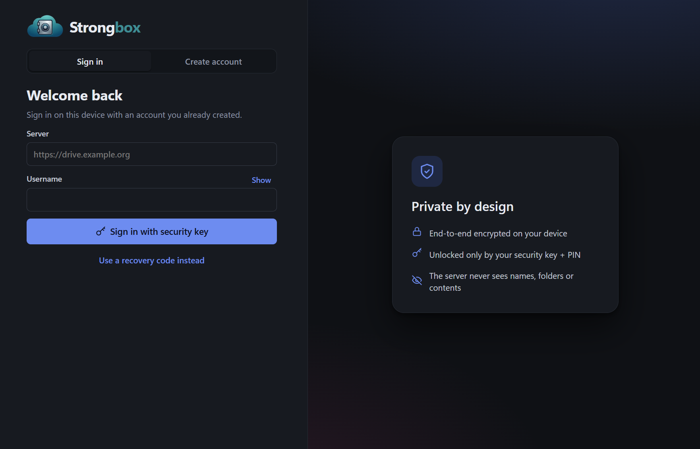
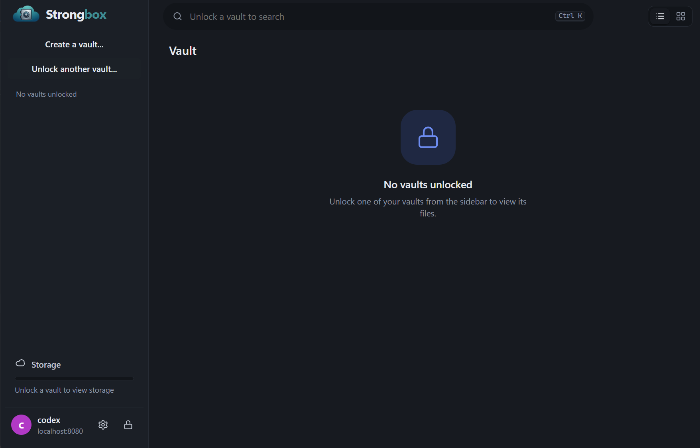
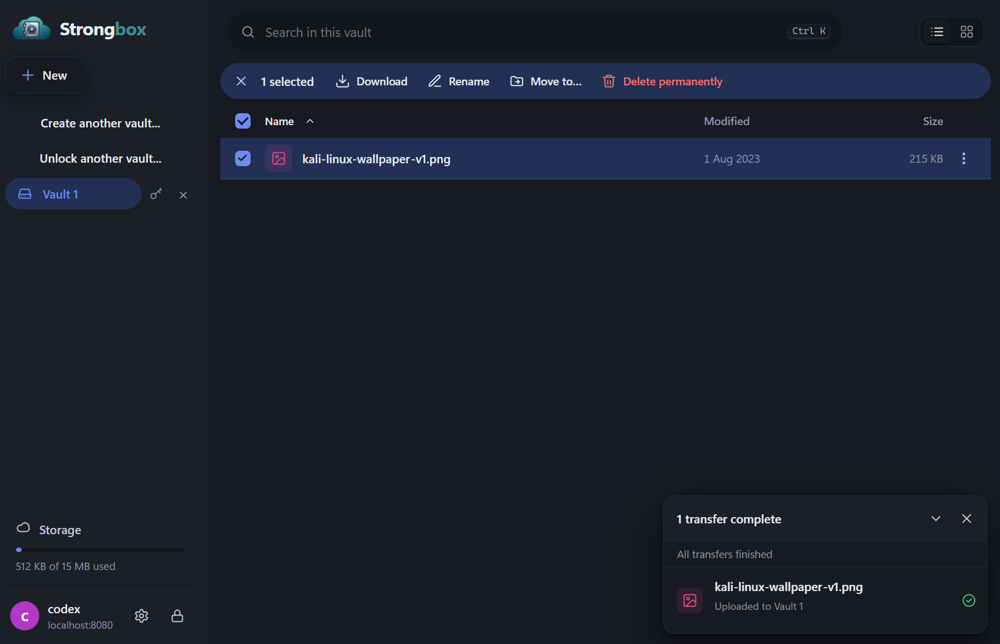
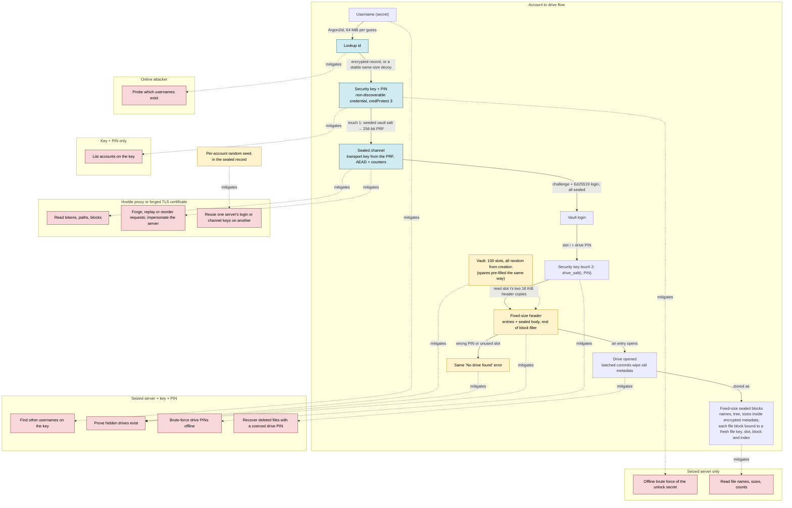

<p align="center">
  
</p>

# Strongbox

An end-to-end encrypted cloud drive unlocked by a FIDO2 security key (YubiKey etc.) and its PIN.

Password-based zero-access services derive your key from your password, so whoever holds
the ciphertext can run an offline dictionary attack against a weak password. Strongbox
derives the key from the security key's **hmac-secret / WebAuthn PRF** output: 256 random bits
that the key releases only after a correct PIN. There is nothing to brute-force offline.

All encryption happens on the client. The server stores a username-sealed credential record and
fixed-size, random-looking blocks. It never sees file names, folder structure, timestamps, exact
sizes or content.

An account is a **vault**: one security key serves any number of secret usernames, each a vault
of 100 fixed-size drives opened by (slot, drive PIN). Unused slots and wrong PINs are
indistinguishable, even to someone holding the server, the key and its PIN. See
[docs/deniable-drives.md](docs/deniable-drives.md).

## An experiment in deniable encryption

The threat model assumes an adversary can obtain or coerce access to the server and the
security key, including its PIN, all at one point in time, as well as any piece of information
they can prove you know. Under that combined snapshot, Strongbox is an experiment in making
other hidden drives difficult to prove. This is a mitigation against an adversary who can only
coerce information they know exists, for example through legal compulsion. Such an adversary
cannot prove that a hidden drive exists, so they have nothing to compel you to reveal. It does
not stop an adversary who suspects hidden drives, because deniability cannot prove there is
nothing more. Its claims depend on the assumptions and limits in the
[deniable-drive design](docs/deniable-drives.md).
The comic below shows the kind of problem this design is intended to address.

[](https://xkcd.com/538/)

*Security, [xkcd #538](https://xkcd.com/538/) by Randall Munroe, used under
[CC BY-NC 2.5](https://creativecommons.org/licenses/by-nc/2.5/).*

## User Interface





### Account to drive flow

Blue: other accounts on the same key, and the sealed transport. Yellow: vault existence. Red: the
attack each design choice mitigates (dotted edges). Sign-up and the username record lookup are
the only calls in the clear; sign-up must happen on a network you trust.



- **Account existence:** not deniable. Registration reveals whether a username is taken, so anyone
  who can try names can confirm that an account exists. Keep registration invite-only.
- **Other accounts on the same key:** the deniable part, under two threat models.
  - *Seized server, plus key and PIN:* the attacker has the server snapshot. The server stores no
    usernames, only Argon2id-derived lookup ids and records encrypted under keys derived from the
    username. Matching the key means guessing usernames offline: for each candidate, one Argon2id
    run (64 MiB), decrypt the record to get its credential ids, then test them on the key (one
    touch). A candidate absent from the lookup table is discarded without touching the key. The
    credentials are non-discoverable, so the key lists nothing.
  - *Key and PIN only, no server access:* the attacker cannot match the key to any account. The
    credentials are non-discoverable, so the key lists nothing, and without the records there are
    no credential ids to test.
- **Vault existence:** a wrong drive PIN and an unused slot give the same result, message and
  timing, and every slot is filled with random bytes at creation, so used and unused slots look alike.

## Layout

| Path | What |
|---|---|
| `crates/core` | Client-side crypto: AEAD and key derivation, vault and drive formats |
| `crates/proto` | HTTP API wire types (everything the server ever sees) |
| `crates/fido` | PRF access: Windows WebAuthn API, CTAP2-HID (Linux/macOS), test-only software key |
| `crates/client` | Client library and the `sbox` CLI |
| `crates/server` | `strongbox-server`: blind storage server (axum, SQLite, `/v2` vault slot store) |
| `apps/desktop` | Tauri desktop app (Rust core plus a dependency-free HTML/JS UI) |
| `docs/` | [deniable drives](docs/deniable-drives.md) (design and crypto), [server plan](docs/server-plan.md) |
| `deploy/` | Caddyfile, Dockerfile, systemd unit |

## Quick start (local)

On Windows, double-click **`start-server.bat`** (open registration on `http://127.0.0.1:8080`; the first
start asks for the network interface (a list), the server port and the admin page port; data in `strongbox-data\`, a small vault layout; extra arguments such as `--debug` are passed
through, and every default can be overridden with the matching `STRONGBOX_*` environment
variable), then **`start-client.bat`** for the desktop app. **`reset-server.bat`** permanently
deletes that server data directory after an explicit confirmation. `start-client.bat --soft` uses the
insecure software key, to try the UI without a security key. Or by hand:

```sh
# 1. Server (open registration for local testing). Logging is privacy-preserving by default;
#    add --debug (or STRONGBOX_DEBUG=true) for request traces and full error details.
cargo run -p strongbox-server -- --registration open

# 2a. CLI: insert your security key (it must have a PIN set)
cargo run -p strongbox-client --bin sbox -- create --server http://127.0.0.1:8080
cargo run -p strongbox-client --bin sbox -- open --server http://127.0.0.1:8080 3

# 2b. Desktop app
cargo run -p strongbox-desktop
```

### Invite codes and the admin page

With `--registration invite`, an account needs an invite code: the shared `--invite-token`, or a
code created on the admin page. The page has its own port (`--admin-listen`, default
`http://127.0.0.1:4444/`); open it in a browser on the server machine. There you can create and delete **standard** codes (valid for any number of
accounts until deleted; you may pick the text) and **single-use** codes (generated, and removed the
moment they admit one account; a failed sign-up does not spend them). It also shows:

- **Problems that need attention:** open registration, debug logging, low disk space, accounts
  whose vault files are missing, and sustained high CPU.
- **Live machine graphs:** CPU, memory, the server's I/O and network traffic. They cover the last
  15 minutes and are kept in memory only.
- **Capacity:** free disk, how many more accounts fit, Strongbox's own disk use and spare vaults.
- **Accounts and configuration:** account, key and session counts, and the settings in effect.

The server cannot see names, files or how much of a vault holds data, so none of that is shown.

The page has no login of its own. It is a separate listener that must be a loopback address, and it
is served only to a browser on the same machine: requests that come through a proxy (forwarded
headers), arrive over a non-loopback connection or carry a foreign `Host` get a 404, so the TLS
proxy in `deploy/` never exposes it. On a remote server, reach it
through an SSH tunnel (`ssh -L 4444:127.0.0.1:4444 host`).

### Vaults (desktop and CLI)

Every vault is allocated and filled with random bytes in full when it is created
(`--vault-slots` × `--vault-slot-blocks` × 256 KiB; the defaults are 100 × 1024, i.e. 25 GiB
per vault). Use a small layout for local testing; all vaults on a server share one layout.
The server keeps `--spare-vaults` (default 1) vaults filled in advance so sign-up does not
wait for the fill; each spare takes one vault's worth of disk (0 turns this off).

```sh
cargo run -p strongbox-server -- --registration open --vault-slots 100 --vault-slot-blocks 16
```

The username and drive PIN are asked for at hidden prompts (never on the command line).
Choose a username nobody could guess: it works like a password. Drive PINs need at least 8
characters; 10+ digits or a passphrase is recommended. Nothing about vaults is stored on the
computer or the security key.

The desktop client creates an account, signs in with a key, creates a vault, opens or resets
a slot, adds another security key, and deletes the account. It also has
drag-and-drop upload of files and folders (onto the window or onto a specific folder),
drag-to-move, multi-select, vault-wide search, in-app preview (images, PDF, audio, video, text)
decrypted in memory, replace/keep-both on name clashes, cancellable parallel transfers, folder
download, idle auto-lock, an optional panic key (1–3 keys held together, set in Account
security; off by default) that instantly locks and securely wipes all keys from memory, and
light/dark themes. Vaults have no trash: deletion is permanent.

Plain `http://` is accepted only for localhost. Real deployments go behind TLS (see `deploy/`).

### Transport security

TLS is treated as optional protection. After sign-up, every API call is sealed in an
end-to-end encrypted, authenticated channel keyed by a per-key `transport_key` derived from the
security key's PRF output , so a hostile HTTP/SOCKS proxy, or a forged TLS
certificate, sees only ciphertext and cannot read, alter, replay or answer requests (it can
drop or delay them). Nothing is
pinned or stored on the computer. **Sign up on a network you trust:** sign-up (and the
username record lookup) are the only calls in the clear, and sign-up carries the transport key.

Still visible to a network observer: IP addresses, timing and message sizes. Details and
limits: [deniable-drives.md §8.1](docs/deniable-drives.md#81-sealed-channel).

Without a security key, for UI development only, build with the insecure software
authenticator and point it at a state file:

```sh
STRONGBOX_SOFT_AUTHENTICATOR=/tmp/softkey.json cargo run -p strongbox-desktop --features dev-soft-authenticator
```

## Platform support for the security key

| Platform | Backend | Notes |
|---|---|---|
| Windows 11 22H2+ | `webauthn.dll` | No admin rights needed; the PIN is entered in the Windows dialog |
| Linux, macOS | CTAP2 over USB HID (`authenticator` crate) | PIN prompted by Strongbox; on Linux needs udev access to hidraw |

All backends use WebAuthn PRF semantics, so a credential enrolled on one platform should
unlock on the others.

## Tests

```sh
cargo test --workspace
```

`crates/client/tests/vault_e2e.rs` runs a real server and client with the software
authenticator: two usernames on one key, decoy and hidden drives, wrong PIN vs unused slot,
backup keys, account deletion, and the seized-server view (one same-size file per vault,
no plaintext, no usernames).
`crates/client/tests/transport.rs` checks that the client never follows redirects and refuses
plain HTTP to remote hosts. `crates/client/tests/hostile_proxy.rs` puts a recording, tampering
proxy between client and server: nothing but ciphertext crosses it, and replayed, forged,
tampered and impersonated messages are refused.

## Status

Early prototype. **Not audited.** Before relying on it:

- The desktop app has been tested on a YubiKey C NFC (firmware 5.8). A raw CTAP probe also confirmed touch enforcement
  and credProtect on a YubiKey 5, firmware 5.8. Cross-platform PRF equality still needs
  confirming on hardware.
- Desktop vault flows have not yet been run against a physical security key.
- See the hardening backlog in [docs/server-plan.md](docs/server-plan.md#3-hardening-backlog).

There are no recovery codes: any recovery secret would be something a record or the server could
point at, and deniability comes first. Grant at least two security keys to every vault you care
about. Losing every key that opens a vault, or its passphrase, means losing the data. Nobody,
including the server operator, can recover it.

## References

- [FidoVault](https://github.com/tmo1/fidovault): a reference for Strongbox's multi-authenticator
  multi-authenticator design.
- [Deniable encryption](https://en.wikipedia.org/wiki/Deniable_encryption): Made me go down this rabbithole.

## License

MIT. See [COPYING](COPYING).

## AI usage

The design and implementation decisions (and other bad ideas), are mine. Most of the code
was generated by AI as a quick experiment.
