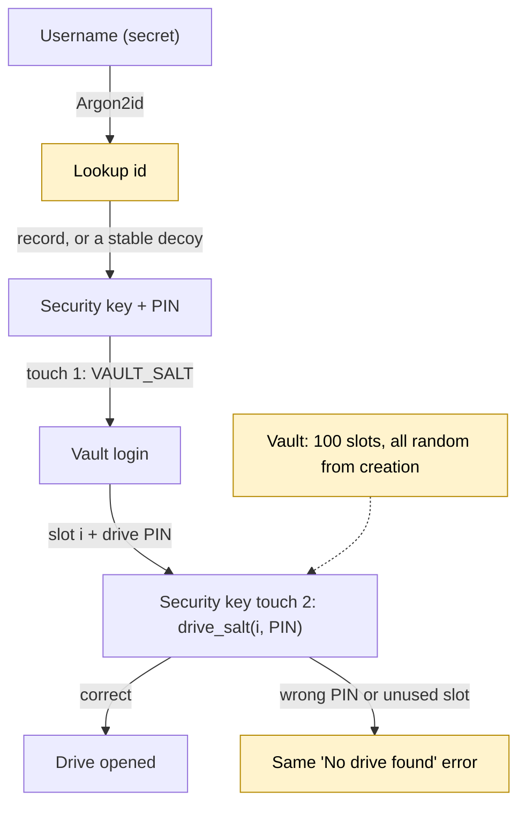

<p align="center">
  
</p>

# Strongbox

An end-to-end encrypted cloud drive unlocked by a FIDO2 security key (YubiKey etc.) and its PIN.

Password-based zero-access services derive your key from your password, so whoever holds
the ciphertext can run an offline dictionary attack against a weak password. Strongbox
derives the key from the security key's **hmac-secret / WebAuthn PRF** output: 256 random bits
that the key releases only after a correct PIN. There is nothing to brute-force offline. A
password can optionally be required as well.

All encryption happens on the client. The server stores opaque keyslots, sealed directory nodes
and encrypted chunks. It never sees file names, folder structure, timestamps, exact sizes or
content.

For users facing coercion there are also **deniable vaults**: one security key serves any
number of secret usernames, each a vault of 100 fixed-size drives opened by (slot, drive PIN).
Unused slots and wrong PINs are indistinguishable, even to someone holding
the server, the key and its PIN. See [docs/deniable-drives.md](docs/deniable-drives.md).

## An experiment in deniable encryption

The threat model assumes an adversary can obtain or coerce access to the server and the
security key, including its PIN, all at one point in time, as well as any piece of information
they can prove you know. Under that combined snapshot, Strongbox is an experiment in making
other hidden drives difficult to prove. It does not stop coercion or physical force, and its
claims depend on the assumptions and limits in the [deniable-drive design](docs/deniable-drives.md).
The comic below is a useful reminder that encryption cannot solve every part of a threat model.

[](https://xkcd.com/538/)

*Security, [xkcd #538](https://xkcd.com/538/) by Randall Munroe, used under
[CC BY-NC 2.5](https://creativecommons.org/licenses/by-nc/2.5/).*

### Account to drive flow

Shaded nodes are where deniability comes from:



1. An unknown username gets a decoy record of the same size, so online probing reveals nothing.
2. A wrong drive PIN and an unused slot give the same result, message and timing.
3. Every slot is filled with random bytes at creation, so used and unused slots look alike.

## Layout

| Path | What |
|---|---|
| `crates/core` | Client-side crypto: keyslots, Padmé padding, sealed nodes, chunked content encryption, vault formats |
| `crates/proto` | HTTP API wire types (everything the server ever sees) |
| `crates/fido` | PRF access: Windows WebAuthn API, CTAP2-HID (Linux/macOS), test-only software key |
| `crates/client` | Client library and the `sbox` CLI |
| `crates/server` | `strongbox-server`: blind storage server (axum, SQLite, pluggable blob store, `/v2` vault slot store) |
| `apps/desktop` | Tauri desktop app (Rust core plus a dependency-free HTML/JS UI) |
| `docs/` | [crypto spec](docs/crypto-spec.md), [deniable drives](docs/deniable-drives.md), [server plan & decentralization roadmap](docs/server-plan.md) |
| `deploy/` | Caddyfile, Dockerfile, systemd unit |

## Quick start (local)

On Windows, double-click **`start-server.bat`** (open registration on `http://127.0.0.1:8080`,
data in `strongbox-data\`, a small vault layout; extra arguments such as `--debug` are passed
through, and every default can be overridden with the matching `STRONGBOX_*` environment
variable), then **`start-client.bat`** for the desktop app. **`reset-server.bat`** permanently
deletes that server data directory after an explicit confirmation. `start-client.bat --soft` uses the
insecure software key, to try the UI without a security key. Or by hand:

```sh
# 1. Server (open registration for local testing). Logging is privacy-preserving by default;
#    add --debug (or STRONGBOX_DEBUG=true) for request traces and full error details.
cargo run -p strongbox-server -- --registration open

# 2a. CLI: insert your security key (it must have a PIN set)
cargo run -p strongbox-client --bin sbox -- register --server http://127.0.0.1:8080 --username alice
cargo run -p strongbox-client --bin sbox -- put ./some-file.pdf
cargo run -p strongbox-client --bin sbox -- ls
cargo run -p strongbox-client --bin sbox -- shell        # unlock once, run many commands
# On another computer, sign in to the existing account:
cargo run -p strongbox-client --bin sbox -- login --server http://127.0.0.1:8080 --username alice
# rm moves to the trash; see `trash list|restore|empty`, `rm --permanent`, `find <text>`

# 2b. Desktop app
cargo run -p strongbox-desktop
```

### Deniable vaults (desktop and CLI)

Every vault is allocated and filled with random bytes in full when it is created
(`--vault-slots` × `--vault-slot-blocks` × 256 KiB; the defaults are 100 × 1024, i.e. 25 GiB
per vault). Use a small layout for local testing; all vaults on a server share one layout.

```sh
cargo run -p strongbox-server -- --registration open --vault-slots 100 --vault-slot-blocks 16
cargo run -p strongbox-client --bin sbox -- vault create --server http://127.0.0.1:8080
cargo run -p strongbox-client --bin sbox -- vault open --server http://127.0.0.1:8080 3
cargo run -p strongbox-client --bin sbox -- vault recover --server http://127.0.0.1:8080
```

The username and drive PIN are asked for at hidden prompts (never on the command line).
Choose a username nobody could guess: it works like a password. Drive PINs need at least 8
characters; 10+ digits or a passphrase is recommended. Nothing about vaults is stored on the
computer or the security key.

The desktop client can create a vault and its first drive, open or reset a slot, unlock from
a drive recovery code, add another security key or recovery code, and browse, search, preview,
upload, download, move and permanently delete files. Vault drives do not have trash or account
deletion controls.

The desktop app has sign-in for existing accounts on new devices, drag-and-drop upload of files
and folders (onto the window or onto a specific folder), drag-to-move, multi-select, a trash with
undo, drive-wide search, in-app preview (images, PDF, audio, video, text) decrypted in memory,
replace/keep-both on name clashes, cancellable parallel transfers, folder download, idle
auto-lock, an optional panic key (1–3 keys held together, set in Settings; off by default)
that instantly locks and securely wipes all keys from memory, and light/dark themes.

Plain `http://` is accepted only for localhost. Real deployments go behind TLS (see `deploy/`).

Without a security key, for UI development only, build with the insecure software
authenticator and point it at a state file:

```sh
STRONGBOX_SOFT_AUTHENTICATOR=/tmp/softkey.json cargo run -p strongbox-desktop --features dev-soft-authenticator
```

## Platform support for the security key

| Platform | Backend | Notes |
|---|---|---|
| Windows 11 22H2+ | `webauthn.dll` | No admin rights needed; the PIN is entered in the Windows dialog |
| Linux, macOS | CTAP2 over USB HID (`authenticator` crate) | PIN prompted by Strongbox; on Linux needs udev access to hidraw |

All backends use WebAuthn PRF semantics, so a credential enrolled on one platform should
unlock on the others.

## Tests

```sh
cargo test --workspace
```

`crates/client/tests/end_to_end.rs` runs a real server and client with the software
authenticator. It covers sign-up, multi-chunk upload/download, concurrent writers, rename/move,
recursive delete, a second key, recovery codes and garbage collection. It also checks that
nothing the server persisted contains file names, folder names or file content.

`crates/client/tests/vault_e2e.rs` does the same for deniable vaults: two usernames on one key,
decoy and hidden drives, wrong PIN vs unused slot, backup keys, recovery codes, and the
seized-server view (identical slot files, no plaintext, no usernames).
`crates/client/tests/transport.rs` checks that the client never follows redirects and refuses
plain HTTP to remote hosts.

## Status

Early prototype. **Not audited.** Before relying on it:

- The desktop app has been tested on a YubiKey C NFC (firmware 5.8). A raw CTAP probe also confirmed touch enforcement
  and credProtect on a YubiKey 5, firmware 5.8. Cross-platform PRF equality still needs
  confirming on hardware.
- Desktop vault flows have not yet been run against a physical security key.
- See the hardening backlog in [docs/server-plan.md](docs/server-plan.md#6-security-hardening-backlog).

Always enroll at least two security keys, or a key plus the recovery code. Losing every
unlock method means losing the data. Nobody, including the server operator, can recover it.

## References

- [FidoVault](https://github.com/tmo1/fidovault): a reference for Strongbox's multi-authenticator
  keyslot design.

## License

MIT. See [COPYING](COPYING).

## AI usage

The design and implementation decisions (and other bad ideas), are mine. Most of the code
was generated by AI as a quick experiment.
